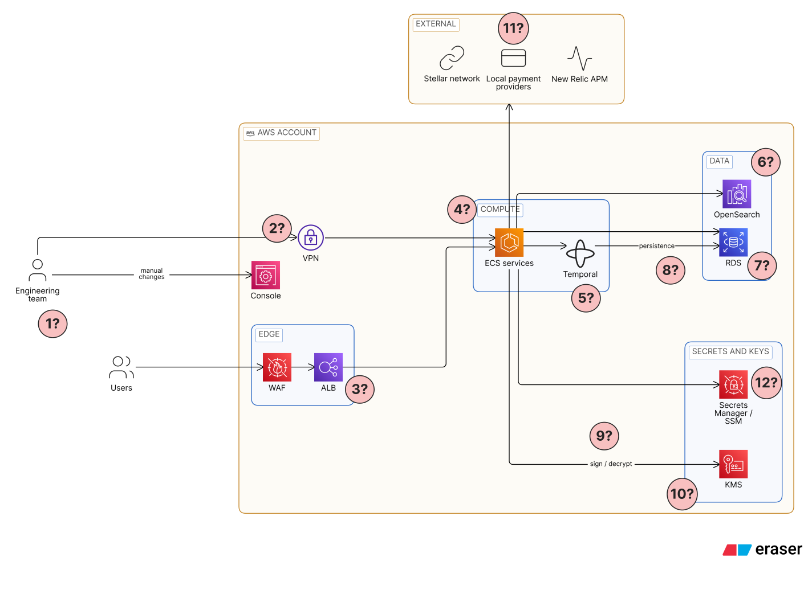
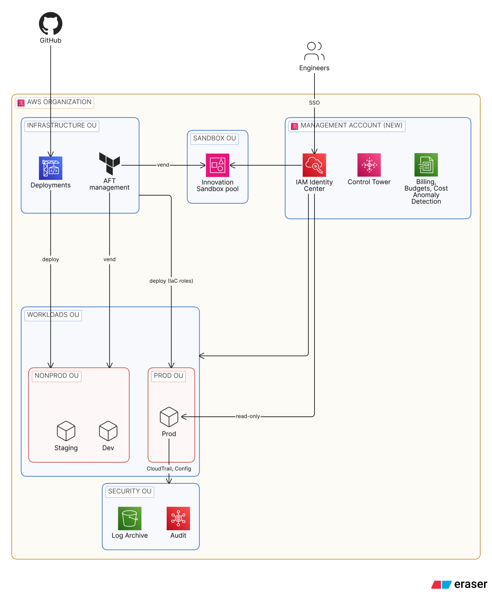
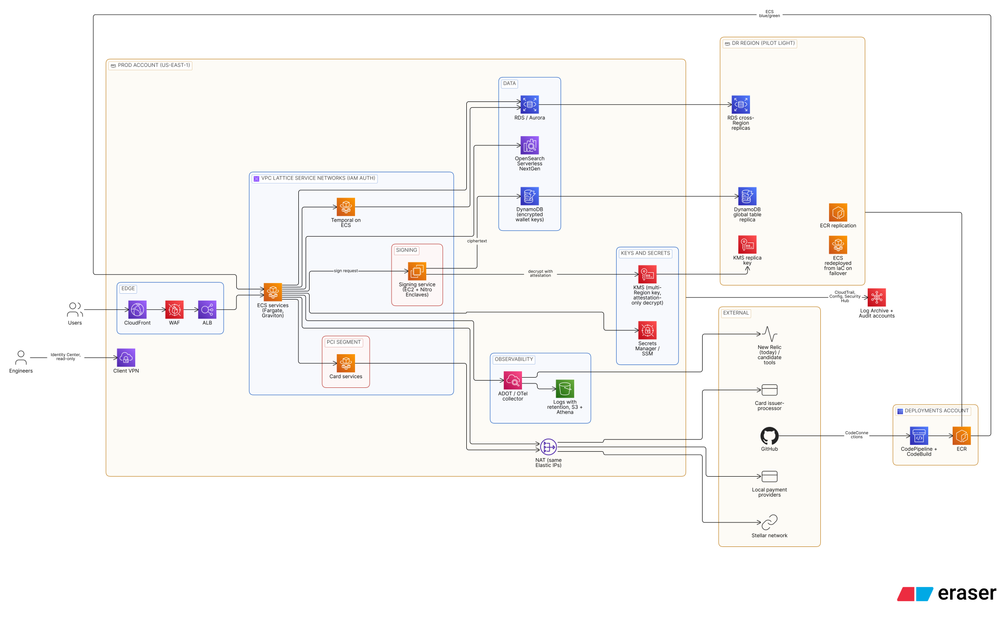

# Arquitectura

* Autor: **Camilo Rozo**

## Arquitectura actual

Kova opera en una sola cuenta de AWS donde conviven producción y no productivo, sin infraestructura como código: los cambios se hacen a mano en la consola. Los usuarios entran por WAF y balanceadores hacia servicios en ECS; el equipo entra por una VPN. Los servicios usan RDS, OpenSearch y Temporal, y se conectan con proveedores de pagos locales y con la red Stellar. New Relic recibe la telemetría.

Cada marca `?` es una suposición o ambigüedad; todas están en la [tabla de suposiciones](decisiones_short.md#suposiciones).

* **1?** Equipo: 10 ingenieros, dos turnos de guardia 24/7.
* **2?** VPN: producto y proveedor desconocidos.
* **3?** Balanceadores: uno por servicio o compartidos, desconocido.
* **4?** ECS: hasta 100 servicios; número de clusters, tipo de lanzamiento y autoescalado desconocidos.
* **5?** Temporal: self-hosted en ECS.
* **6?** OpenSearch: configuración y propósito desconocidos.
* **7?** RDS: hasta 30 bases con motores, tamaños y propósitos diversos.
* **8?** Persistencia de Temporal: qué base y motor, desconocido.
* **9?** Uso de KMS por los servicios (firma o cifrado), desconocido.
* **10?** Llaves de firma de wallets: en KMS o cifradas en un almacén existente.
* **11?** Proveedores de pagos: tienen en lista blanca las IPs de salida de Kova.
* **12?** Secretos de configuración: en Secrets Manager / SSM.

## Arquitectura objetivo (12 meses)

### Organización y cuentas

* **O1** Una cuenta de administración nueva, sin cargas, con Organizations, Control Tower, IAM Identity Center y la facturación consolidada.
* **O2** Las cuentas Log Archive y Audit de Control Tower reciben CloudTrail, Config y Security Hub.
* **O3** AFT crea staging, dev y el pool de sandboxes, cada una con su línea base de roles, etiquetas y presupuestos.
* **O4** La cuenta actual se une sin cambios como producción, en una OU transitoria: personas solo lectura, cambios solo por IaC.
* **O5** Staging y dev reciben todo lo que no es producción; tienen SCPs restrictivas.
* **O6** Innovation Sandbox presta cuentas temporales con tope de costo y limpieza automática.
* **O7** CodePipeline y CodeBuild en la cuenta de Deployments despliegan en cada cuenta con roles de IaC.
* **O8** Los ingenieros entran con IAM Identity Center.

### Plataforma de producción

1. Los usuarios entran por CloudFront y el WAF actual hacia los ALB; DNS y endpoints no cambian.
2. Los servicios de ECS pasan a Fargate con Graviton y rightsizing; Temporal sigue en ECS.
3. Los servicios se comunican por VPC Lattice con políticas de IAM.
4. Los servicios de tarjetas están en su propia service network; el issuer-processor guarda los datos de tarjeta.
5. Un servicio pide una firma al servicio de firma (EC2 con Nitro Enclaves).
6. El enclave lee la llave cifrada de DynamoDB, la descifra con una llave de KMS que solo acepta su atestación, firma y la descarta.
7. Stellar, los proveedores de pagos y el procesador se alcanzan por el mismo NAT y las mismas IPs de hoy.
8. Datos en RDS (o Aurora) y OpenSearch Serverless NextGen; secretos en Secrets Manager / SSM.
9. Todo servicio emite OpenTelemetry a un colector ADOT; New Relic se mantiene mientras se evalúan alternativas.
10. Todo log tiene retención; lo antiguo se archiva en S3 y se consulta con Athena.
11. GitHub, CodePipeline y CodeBuild, ECR y despliegue blue/green nativo de ECS.
12. El equipo entra por AWS Client VPN con IAM Identity Center; en producción solo lee.
13. CloudTrail, Config y Security Hub reportan a las cuentas Log Archive y Audit.
14. Región de DR en pilot light: réplicas de RDS, tabla global de DynamoDB, llave réplica de KMS y ECR replicado; ECS se crea con Terraform al conmutar.

Las decisiones detrás de cada paso están en [decisiones_short.md](decisiones_short.md).
